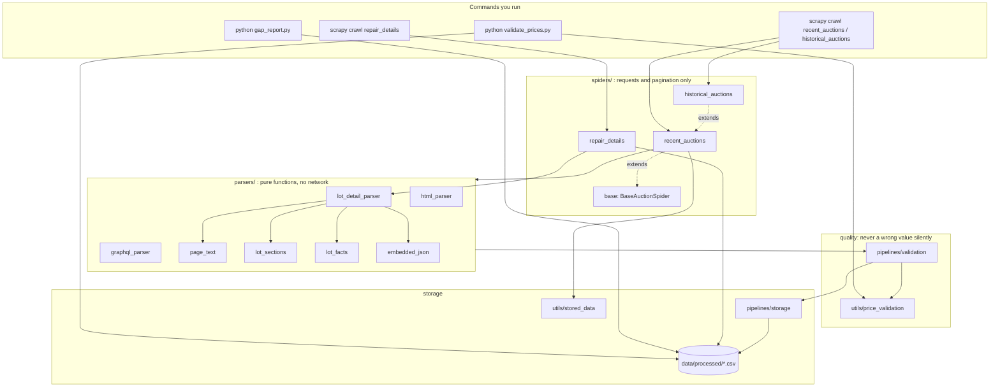
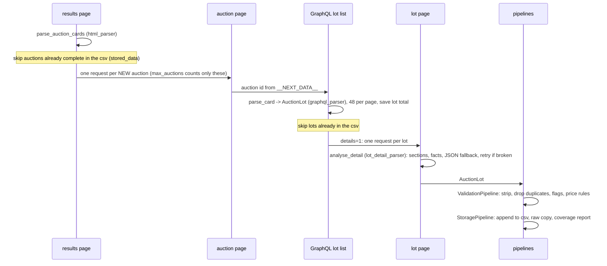

# Architecture

How the scraper is built, what each module does, and where to change things.
Read this first; then `README.md` for commands and `DECISIONS.md` for the *why*.

## In one paragraph

Scrapy crawls Sotheby's **public** pages: the results list, each auction page, the site's GraphQL
lot list (48 lots per request) and, with `details=1`, each lot's own page. **Parsers** turn
responses into one `AuctionLot` row each and never touch the network. **Pipelines** clean and
check every row, then append it to one CSV per run type. **Tools** outside Scrapy measure the gaps,
repair blanks in an existing CSV and check every sold price. Nothing ever overwrites a value that is
already stored, and every row says how far it got (`parse_quality`) and what is doubtful
(`data_quality_flags`).

## Many sources, one schema

Each auction house is one spider that inherits `spiders/base.py::BaseAuctionSpider` and one parser
that returns `AuctionLot`. The base holds everything shared (resume, limits, retries, empty-section
re-fetch, failure logging, run summary); the source only writes how to find auctions, lots and
fields on its site. The validation pipeline drops anything that is not an `AuctionLot` and stamps
`source` from the spider, so every csv has the same columns. How to add one: `ADDING_A_SOURCE.md`.

## Layers



## How one crawl flows



## Module map

| Module | Job | Main names | Network? |
|---|---|---|---|
| **config/** | | | |
| `config/settings.py` | Scrapy settings and every constant: folders, politeness, retries, URLs, GraphQL query | `PROCESSED_DIR`, `RAW_DIR`, `LOT_QUERY`, `PAGE_SIZE` | – |
| **models/** | | | |
| `models/auction_lot.py` | The one row schema. Field order = CSV column order | `AuctionLot`, `FIELDS`, `LOT_STATUSES`, `merge_flags` | – |
| **parsers/** (pure functions) | | | |
| `parsers/common.py` | Small converters | `to_int`, `clean_text`, `utc_now_iso` | – |
| `parsers/html_parser.py` | Results page (auction cards, next page, dates) and older `/ecatalogue/` lot pages | `parse_auction_cards`, `parse_legacy_lot` | – |
| `parsers/graphql_parser.py` | One GraphQL lot card → one `AuctionLot`; lot status (hidden ≠ unsold) | `parse_card`, `parse_connection`, `derive_status` | – |
| `parsers/lot_detail_parser.py` | **Entry point for a lot page**: what it gave, what is blank and why; merge into a lot | `analyse_detail` → `DetailReport`, `merge_detail` | – |
| `parsers/page_text.py` | HTML → clean lines; split English from the translation | `visible_lines`, `html_to_text`, `english_part` | – |
| `parsers/lot_sections.py` | Page headings → columns; sub-headings inside a text (`RELATED LITERATURE`) | `HEADINGS`, `split_sections`, `split_subsections` | – |
| `parsers/lot_facts.py` | Dimensions, medium, year from the description (all heuristics in one place) | `extract_facts`, `find_size`, `infer_medium`, `facts_from_text` | – |
| `parsers/embedded_json.py` | The page's own JSON when the visible text is empty | `lot_text_from_json`, `embedded_json` | – |
| **spiders/** (requests only) | | | |
| `spiders/recent_auctions.py` | Results → auction → GraphQL pages → lot pages; skips what is stored | `RecentAuctionsSpider` | yes |
| `spiders/historical_auctions.py` | Same, for a fixed date window, plus older `/ecatalogue/` pages | `HistoricalAuctionsSpider` | yes |
| `spiders/repair_details.py` | Fill blanks in an **existing** CSV: offline pass, then lot pages; never overwrites | `RepairDetailsSpider` | yes |
| **pipelines/** (every crawled row) | | | |
| `pipelines/validation.py` | Strip text, drop rows without/duplicate `lot_id`, add quality flags and price rules | `ValidationPipeline` | – |
| `pipelines/storage.py` | Append to the CSV, add new columns to an old CSV, save raw responses, coverage report | `StoragePipeline`, `migrate_header`, `save_raw_response` | – |
| **utils/** | | | |
| `utils/price_validation.py` | **Every rule a sold price must pass**; strict price-text reader | `check_sold_price`, `parse_price_text` | – |
| `utils/stored_data.py` | What a CSV already holds, so re-runs skip it | `StoredData`, `norm_url` | – |
| `utils/results_url.py` | The results-page URL for a date window | `build_results_url` | – |
| `utils/repair.py` | Pure helpers for `repair_details`: read/write CSV, fill only blank cells | `fill_blanks`, `offline_fill`, `rows_needing_repair` | – |
| `utils/retries.py` | Retries that log the reason; "soft" retries for pages that loaded but had no data | `LoggingRetryMiddleware`, `retry_request` | – |
| `utils/logs.py` | Ledger of everything NOT stored, with the reason | `log_not_stored`, `NotStoredLog` | – |
| **tools** (project root) | | | |
| `gap_report.py` | Blank counts per column (withdrawn vs other), `parse_quality`, lots to open by hand | `main`, `column_table` | – |
| `validate_prices.py` | Check every sold price in a CSV; exit code 1 on any error | `main`, `validate` | – |
| `make_zip.py` | Zip the project without secrets, caches or raw pages | – | – |

## Files the project writes

| File | Written by | What it is |
|---|---|---|
| `data/processed/<spider>_<version>.csv` | StoragePipeline, repair_details | **The data.** One row per lot, `lot_id` is the key |
| `…_coverage.json` | StoragePipeline | Fill rate per column for the last run |
| `…_auction_totals.json` | recent_auctions | The site's lot total per auction (decides "complete" for skipping) |
| `….bak.csv` | repair_details | The CSV before the FIRST repair. Never changed afterwards |
| `….repair_log.csv` | repair_details | Every cell a repair filled: lot, column, source, value |
| `….price_check.csv` | validate_prices.py | Every price error / warning, with the rule |
| `….before_new_columns.csv` | StoragePipeline | The CSV before new model columns were added |
| `data/raw/<spider>/…` | spiders | Exact responses, so a parser fix never needs a re-crawl |
| `data/logs/*_not_stored.csv` | utils/logs.py | One line per item not stored, and why |

## The rules the code follows

1. **Parsers never touch the network; spiders never parse.** Every parser is a pure function that
   can be tested with a saved page.
2. **Never overwrite, never guess.** Blank cells are filled; filled cells are never changed. An
   unclear value (`12.700 EUR`, an unknown time zone) is left blank, not guessed.
3. **Blank is not zero, hidden is not unsold.** `None`/blank = not available; `0` is a real value;
   `hidden` = the public page shows no result.
4. **Every row says how far it got and what is doubtful:** `parse_quality` (`detail` = lot page
   read, `good` = list card only) and `data_quality_flags`.
5. **Nothing is lost silently.** Every dropped item or failed page is in `data/logs/*_not_stored.csv`.
6. **A wrong price is worse than a blank one.** Every price passes `utils/price_validation.py`.
7. **Polite and public.** robots.txt obeyed, a few seconds between requests, stop on 403/429,
   no login, no credentials (D25).

## Recipes

**Add a column.** Add the field to `models/auction_lot.py` (its position = CSV position), fill it in
the parser that sees it, add a test. Existing CSVs get the empty column automatically on the next
crawl (`migrate_header`, a copy is kept).

**The site renamed a heading** (e.g. "Literature" → "References"). Add it to `HEADINGS` in
`parsers/lot_sections.py`, and a test in `tests/test_detail_gaps.py`.

**Sizes or media are missed.** All patterns are in `parsers/lot_facts.py`. Add the failing text as a
test first, then change the pattern. `python gap_report.py <csv>` shows the effect.

**A new price rule.** Add it to `check_sold_price` in `utils/price_validation.py` with a test in
`tests/test_price_validation.py`. It then runs on every crawled row and in `validate_prices.py`.

**Pages come back empty.** Open the saved page in `data/raw/`. Text in `__NEXT_DATA__` only: add
its key to `JSON_KEYS` in `parsers/embedded_json.py`.

## Routine

```sh
scrapy crawl recent_auctions -a days=30 -a details=1          # new auctions only (stored ones skipped)
python gap_report.py data/processed/recent_auctions_recent.csv description
scrapy crawl repair_details -a source=data/processed/recent_auctions_recent.csv -a retries=4   # if blanks
python validate_prices.py                                      # exit code 1 = a price is wrong
pytest -q                                                      # after any code change
```
